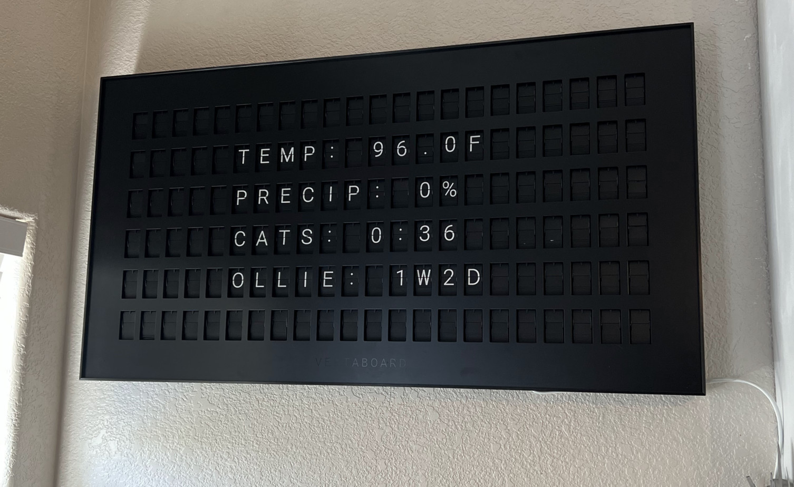

# Vestaboard Display Controller

A Python-based controller for Vestaboard that displays personalized real-time information including weather, time tracking, and custom counters. Saves $7/month by avoiding Vestaboard's subscription service



## What It Does

This script updates the Vestaboard every 20 minutes:
- **Current Weather**: Temperature and UV index for your location
- **Work/Activity Time**: Fetches time data from [cat work tracker](https://tylerbarron.com/CatTracker). When the cats have logged more than 30 minutes and one cat accounts for 80%+ of that time, the line credits that cat by name (`Tuni:` / `Checo:`) instead of the generic `Cats:`.
- **Custom Date Counter**: Tracks time since a specified date (months or weeks format)
- **Quiet Hours**: Automatically pauses updates during nighttime (11 PM - 6 AM)

## Setup

1. **Install Dependencies**:
   ```bash
   pip install -r requirements.txt
   ```

2. **Configure API Keys**:
   Create a `config.py` file in the same directory (you can copy `config.example.py`):

3. **Get API Keys**:
   - **Vestaboard**: Get your Read/Write key from [Vestaboard API](https://www.vestaboard.com/)
   - **Weather**: Sign up for a free API key at [OpenWeatherMap](https://openweathermap.org/api). The UV index comes from [Open-Meteo](https://open-meteo.com/), which needs no key.

4. **Customize Your Display**:
   - Date tracking: Edit your dates, counter label, and format (months/weeks) in `config.py`
   - Custom API endpoints, update interval, and quiet hours: Edit the constants near the top of `vestaboard.py`

## Running Tests

```bash
python -m unittest test_vestaboard
```

## Running the Script

**Manual Start**:
```bash
python vestaboard.py
```

**Automatic Monitoring** (using the included monitor script):
```bash
chmod +x monitor_script.sh
./monitor_script.sh
```

Add to crontab so it starts after a reboot and restarts if it dies or hangs (the script restarts the service if its log hasn't grown in 2 hours):
```bash
* * * * * /path/to/monitor_script.sh
```

The script logs to stderr; `monitor_script.sh` appends that to `vestaboard.log`. To rotate the log, install the included logrotate config:
```bash
sudo cp vestaboard.logrotate /etc/logrotate.d/vestaboard
```

## Deployment (Raspberry Pi)

The live board is driven by a Raspberry Pi Zero 2 W on the home network. The same Pi also runs CatFinder (the IMX500 camera cat classifier behind the cat work tracker).

| | |
|---|---|
| Hostname | `raspberrypi2.local` (last seen at `192.168.68.70`) |
| User | `admin` (password not stored in this repo) |
| OS | Raspberry Pi OS (Debian 12) |
| Code | `/home/admin/Vestaboard` (CatFinder lives in `/home/admin/CatFinder`) |
| Log | `/home/admin/Vestaboard/vestaboard.log` |

There is a second Pi Zero 2 W on the network (Raspbian 10, seen at `192.168.68.55`). It is **not** the Vestaboard Pi, and it doesn't accept the same credentials.

### Connecting

```bash
ssh admin@raspberrypi2.local
```

If `raspberrypi2.local` doesn't resolve (mDNS is flaky on this network), find the Pi by scanning for SSH, then connect by IP:

```bash
for i in $(seq 1 254); do (nc -z -G 1 192.168.68.$i 22 2>/dev/null && echo 192.168.68.$i) & done; wait
```

If the Pi doesn't answer at all, it has probably hung. Power-cycle it; cron restarts both services within a minute of boot.

### How it runs

There is no systemd service. The `admin` crontab runs each project's monitor script every minute, and the script starts the Python process if it isn't running:

```
* * * * * cd /home/admin/CatFinder && /home/admin/CatFinder/monitor_script.sh
* * * * * cd /home/admin/Vestaboard && /home/admin/Vestaboard/monitor_script.sh
```

Useful checks once connected:

```bash
pgrep -af "vestaboard.py|cat_finder.py"   # are both running?
tail -f ~/Vestaboard/vestaboard.log         # latest board updates
journalctl --list-boots                     # spot reboots or hangs
vcgencmd get_throttled                      # 0x0 = no undervoltage/throttling
```

### Deploying changes

The Pi's copy isn't a git checkout. Copy the changed files over, then kill the process so cron restarts it on the new code:

```bash
scp vestaboard.py admin@raspberrypi2.local:/home/admin/Vestaboard/
ssh admin@raspberrypi2.local 'pkill -f "Vestaboard/vestaboard.py"'
```

`config.py` (API keys) exists only on the Pi and isn't committed.